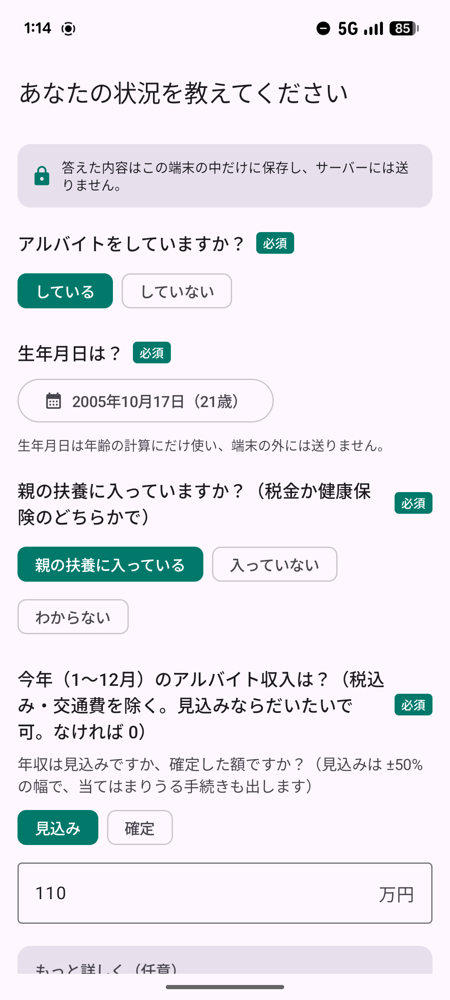
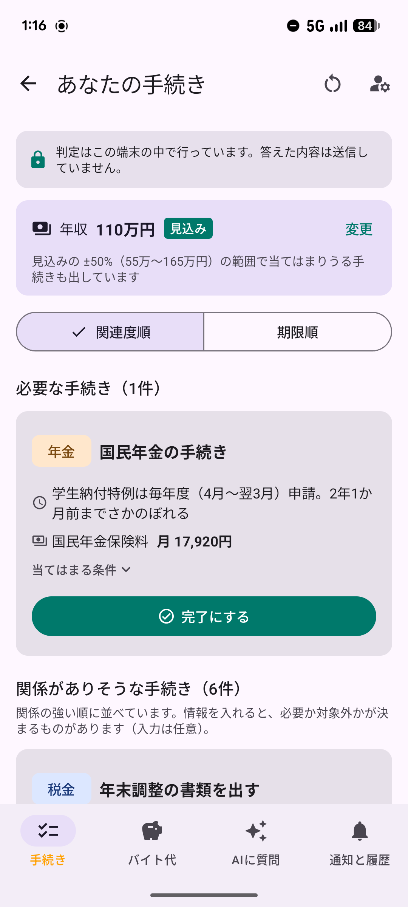
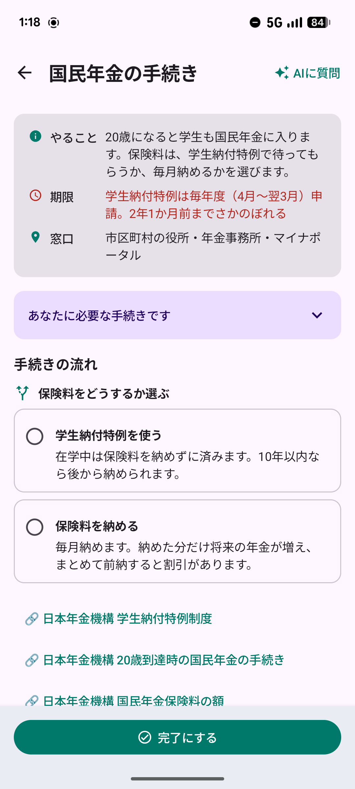
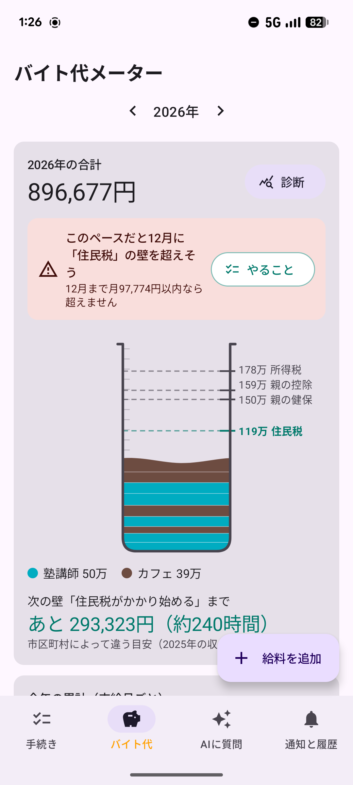
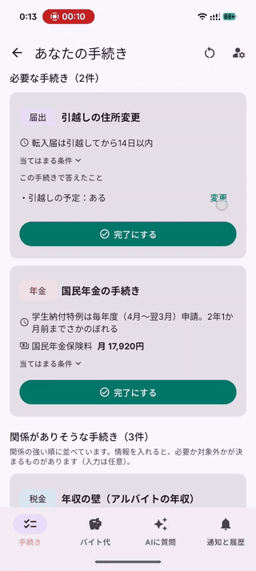
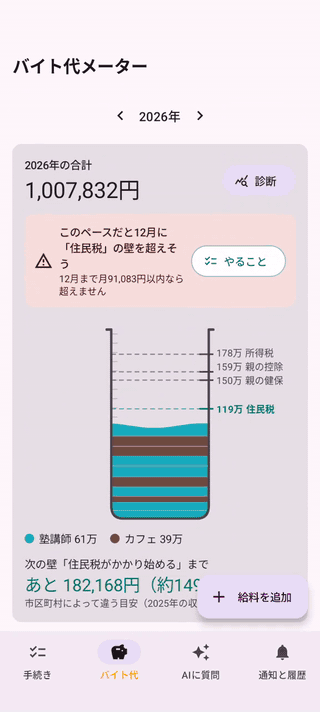
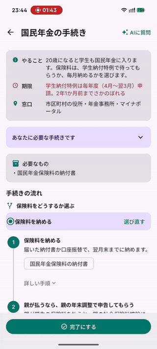
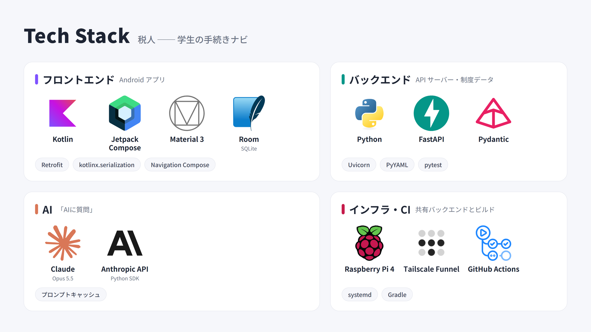

# 税人（ぜいんちゅ）


### ▶ [デモ動画を見る（YouTube・約1分）](https://www.youtube.com/shorts/-FG2OhZyUb4)

> 学生に必要な税金・保険・年金の手続きを、あなたの状況から洗い出し、やる順番と流れを見える化する Android アプリ。

## 製品概要
### 背景（製品開発のきっかけ、課題等）
「扶養から外れると親の税金が上がるらしい」「20歳になったら年金の封筒が来た」──大学生になると、誰からも教わらないまま手続きの当事者になります。

アイデアのきっかけは、メンバー自身が20歳になって国民年金の手続きに直面し、「何から始めればよいかわからない」と困ったことです。学生納付特例は申請したものの、ほかにも払わなければいけない税金がありそうで不安が残りました。年末に今年の収入を数えたら、年収の壁を超えそうになっていたメンバーもいます。

国民年金・国民健康保険・所得税・住民税・親の扶養など、大学生になると自分に関わる手続きが一気に増えます。ところが、いざ調べようとすると次の3つの問題にぶつかります。

#### 1. 情報を探しにくい
手続きは制度ごとに窓口も期限もばらばらで、情報もそれぞれの役所のサイトに分かれています。

| 手続き | 窓口 | 期限 |
| --- | --- | --- |
| 国民年金（学生納付特例） | 市区町村の役所・年金事務所・マイナポータル | 毎年度（4月〜翌3月）申請 |
| 年収の壁（親の扶養の届出） | 親の勤務先 | 年末調整（11〜12月）の前 |
| 確定申告 | 税務署（e-Tax） | 翌年2月16日〜3月15日 |

しかも公式の解説は誰にでも当てはまるように書かれているので、自分に関係があるかどうかは、年齢・年収・扶養の状況を組み合わせて自分で読み解くしかありません。

#### 2. 見落としが心配
知らないまま期限を過ぎると、お金を損したり、いざというときに困ったりします。

- **国民年金**: 20歳になると学生も加入します。学生納付特例の申請が遅れると、申請日より前の事故や病気による障害では、障害基礎年金を受け取れない場合があります[^1]
- **所得税の還付**: 年の途中でアルバイトを辞めて年末調整を受けていないと、給料から天引きされすぎた所得税は、自分で申告しなければ戻ってきません[^2]
- **年収の壁**: 気づかないまま超えると、自分や親の税金・保険料が増え、働いたのに手取りが減ることがあります

#### 3. 全体像がつかめない
自分にはどの手続きが関係して、いつ・何をすればいいのかを一覧で見られる場所がありません。さらに、基準になる金額は毎年のように変わります。2025年には親の控除[^3]と親の健康保険の扶養[^4]の基準が、2026年には所得税がかかり始める年収[^5]が変わりました。年収を気にして働き方を調整している大学生は 54.6% いますが、2025年2月の時点では、そのうち 94.3% が昔からの「103万円」を基準にしていました[^6]。調べたときの情報が、次の年にはもう古くなっていることもあります。

そこで本アプリは、ターゲットを学生にしぼりました。学生は私たち開発者にとって最も身近で、自分にどんな手続きが必要なのか、誰に頼ればいいのかが分からない人も少なくないからです。学生に関係する手続きを1つのアプリにまとめ、税金や手続きに対する漠然とした不安をなくすことを目指しています。

### 製品説明（具体的な製品の説明）
<p align="center">
  
  
  
  
  
</p>

左から ① 最初の質問（4つの基本情報だけ答える）、② あなたの手続き（必要・関係ありそう・対象外に分かれる）、③ 手続きのフロー（当てはまる手順だけを順に）、④ バイト代メーター（次の年収の壁まであといくら）、⑤ AIに質問（自分の状況を前提に聞ける）。

税人は、学生が自分に関係する税金・保険・年金の手続きを知り、期限までに済ませるための Android アプリです。下のタブで4つの画面を切り替えます。

- **手続き**: 最初に4つの質問（アルバイト・生年月日・扶養・年収）に答えると、「あなたの手続き」として、必要な手続き・関係がありそうな手続き・対象外の手続きが理由付きで並ぶ。カードを開くと、その人に当てはまる手順だけがタイムラインで出る。済んだ手続きは「完了」にできる
- **バイト代**: 給料を支給日ごとに記録すると、今年の合計と次の年収の壁までの残り、このペースで壁を超える月、税金の目安が分かる
- **AIに質問**: 手続きについて分からないことを、自分の状況を前提に Claude に聞ける
- **通知と履歴**: 必要な手続きのこれから1年の期限を近い順に並べ、期限が近づくと「もうすぐ」と目立たせる。完了した手続きの履歴も見られる

### 特長
#### 1. 4つ答えるだけで、自分に関わる手続きが分かる
アルバイト・生年月日・扶養の状況・年収に答えると、学生に関係する7つの手続き（年収の壁・親の扶養から外れる・国民年金・確定申告・年末調整・国保に入る・引越し）を「必要な手続き」「関係がありそうな手続き」「対象外の手続き」に分けて出します。カードには **なぜ必要なのか**（例: 親の扶養から外れる手続きなら「年収 1,600,000円（150万円以上）、年末の年齢 21歳（19〜22歳）」）も表示します。

分からない項目は「まだ分からない」として判定し、判定に必要になった手続きのカードでだけ聞き直します。並びは関連度順と期限順を切り替えられます。

<p align="center">
  <a href="https://www.youtube.com/watch?v=gnPkmL9fa1Q"></a>
  <br>
  <a href="https://www.youtube.com/watch?v=gnPkmL9fa1Q">▶ YouTube で動画を見る</a>
</p>

#### 2. 自分に当てはまった手順を、やる順に
各手続きは「何を・どこで・いつ・何を持って」をステップごとのタイムラインで見せます。19〜22歳だけに必要な手順や親の扶養に入っている人だけの手順など、**当てはまらないステップは表示しません**。国民年金の「学生納付特例を使う／保険料を納める」のように、選ぶとその先の手順と金額の目安が出ます。

<p align="center">
  <a href="https://www.youtube.com/watch?v=bZaXowbbu9s"></a>
  <br>
  <a href="https://www.youtube.com/watch?v=bZaXowbbu9s">▶ YouTube で動画を見る</a>
</p>

#### 3. バイト代メーターで年収の壁に気づく
給料を支給日ごとに記録すると、今年の合計をビーカーに積み、**次の年収の壁まであといくらか**と **このペースだと何月に超えるか** を出します。税金の目安や、天引きされた所得税が戻る見込みも分かり、壁からその壁に関係する手続きへ移れます。

<p align="center">
  <a href="https://www.youtube.com/watch?v=PvOR8koGM7Y"></a>
  <br>
  <a href="https://www.youtube.com/watch?v=PvOR8koGM7Y">▶ YouTube で動画を見る</a>
</p>

#### 4. AIチャットボットがユーザーの悩みに寄り添う
Claude に、分からない手続きのことを質問できます。アプリが判定した結果と回答をあらかじめ AI に伝えるので、「私は20歳で年収は…」と書かなくてよく、質問の例を押すだけで聞けます。答えが本人の状況で変わるのにそれが分からないときは、場合分けで長く答えるのではなく **聞き返し**、選んだ答えは判定にも反映されます。

<p align="center">
  <a href="https://www.youtube.com/watch?v=lTXtbVhLZYI"></a>
  <br>
  <a href="https://www.youtube.com/watch?v=lTXtbVhLZYI">▶ YouTube で動画を見る</a>
</p>

### 解決出来ること
- 「自分に何が関係あるのか」を調べる手間がなくなる
- 期限と手順が分かるので、知らないまま期限を過ぎて損をすることを防げる
- 年収の壁を年末に気づくのではなく、超える前に気づいて働き方を決められる
- 判定は端末の中で行い、回答をサーバーに保存しないので、年収や扶養の状況を安心して入力できる（AI に質問するときだけ、必要な値に絞って送る）


### 今後の展望
ターゲットを社会人、個人事業主、高齢者と段階的に広げていき、最終的には多くのユーザーに利用してもらいたい。そのほか、次のことを考えている。

- **卒業・就職への切り替え**: 内定が出た時点で、国民年金から厚生年金への切り替え、親の扶養から外れる手続き、「住民税は就職2年目から引かれ始める」ことなどを先に知らせる
- **留学生の働ける時間**: 留学生のアルバイトは「週28時間まで」と時間で決まっている。バイト代メーターを金額ではなく時間で数える形にして、超えそうなときに知らせる
- **給与明細の読み取り**: 給与明細を撮るだけで、支給額と天引きの所得税をバイト代メーターに入れる。読み取りは端末の中で行い、明細は外に送らない
- **期限の通知**: 年末調整（11月）、確定申告（2〜3月）、国民年金の学生納付特例（4月）などの期限を、通知やカレンダーで知らせる
- **親との共有**: 「年末に年収がこれくらいになりそう」を QR コードで親に渡し、親の側の手続き（扶養から外す届け出など）につなげる。サーバーは通さない
- **市区町村ごとの違い**: 住民税がかかり始める年収や国民健康保険料は自治体によって違うため、住んでいる市区町村に合わせて目安を出す
- **公式サービスへの案内**: 手続きの画面から、マイナポータル（所得・住民税の情報、ねんきんネット）や確定申告書等作成コーナー（マイナポータル連携で控除の証明書を自動で入れられる）の該当ページを開けるようにする。制度データには、e-Gov 法令 API で根拠の条文へのリンクを付ける

### 注力したこと（こだわり等）
#### 1. 最初に聞くのは4つだけ。残りは必要になったときに聞く
入力が多いと、手続きを調べる前に面倒になってしまいます。最初の画面で聞くのは、アルバイト・生年月日・扶養・年収の4つだけにしました。掛け持ち・年末にバイト先に在籍しているか・引越しの予定といった細かい質問は、判定に必要になった手続きのカードの中でだけ聞きます。例えば確定申告のカードでは、まず掛け持ちしているかを聞き、「はい」のときだけ掛け持ち先の給与が20万円を超えるかを聞きます。年収が 178万円以下と分かっていれば、給与の質問は聞きません。答えが分からない項目は「まだ分からない」のままでも判定できます。

#### 2. 個人情報を集めない
名前・住所・学校名は聞きません。判定は端末の中の判定エンジンで行い、サーバーから受け取るのは全員共通の制度データだけなので、回答はサーバーに保存されません。バイト代の記録も端末の中にだけ保存します。AI に質問するときだけ、生年月日は年齢に直すなど、必要な値に絞ってから送ります。送る内容は画面の「AIに伝える情報」で確かめられ、サーバーには保存せず、ログにも本文を残しません。

#### 3. 「なぜ必要か」を必ず見せる
「必要」と言われても、理由が分からなければ動けません。カードには「年収 1,600,000円（150万円以上）、年末の年齢 21歳（19〜22歳）」のように、判定の根拠になった答えと基準の金額を出します。どの手続きが必要かはルールで決め、AI には判定させません。毎回同じ結果になり、根拠を説明できるようにするためです。

#### 4. 読む量を減らす
文章が多いと、手続きそのものを避けたくなります。画面の文字は必要最低限にし、手続きの手順も、その人に当てはまらないステップは最初から出しません。

#### 5. 最新の制度に合わせる
年収の壁の基準は、2025年・2026年と続けて変わっています。インターネット上には昔の「103万円」を前提にした情報がまだ多いので、すべての基準を 2026年分の制度で書き直し、公的機関のページで確かめたうえで出典を制度データに残しました。

#### 6. 学生に関係する手続きに絞る
最初は退職・開業・出産なども含めて手続きを集めていましたが、対象を学生にしたときに、学生にほとんど関係しない手続きは外しました。そのうえで、学生に起きやすく、知らないと損をする手続きを7つ選びました。「対象外の手続き」も理由付きで見せるので、自分に関係がないことまで確かめられ、漏れがないかを心配せずに済みます。

#### 7. 期限を逃さない
「必要な手続き」は自動で、「関係がありそうな手続き」は本人が「当てはまる」を押したものだけを、「通知と履歴」の画面に期限の近い順で並べます。ルールで決めきれない手続きを勝手に増やさないので、やることの一覧が膨らみません。関係がありそうなだけの手続きはスイッチを入れたときだけ薄い文字で出し、必要なものと区別しました。済んだ手続きは「完了」にすると一覧から外れて履歴に移るので、やることだけが残ります。

#### 8. 毎月続けられるバイト代メーター
年収の壁に気づくには、毎月の記録が欠かせません。給料を追加するときは前回のバイト先と金額を最初から入れておくので、毎月の入力は数秒で終わります。

#### 9. ひと目で分かる画面
数字や文章を読まなくても状況が分かるようにしました。バイト代メーターは、給料をバイト先ごとの色の層としてビーカーに積み、年収の壁を目盛りにしています。壁を1つ超えるごとにガラスにひびが入り、超えそうなときは「12月まで月◯円以内なら超えません」と、どうすれば超えないかまで示します。手続きの画面では、判定に必要な質問をカードの中で1タップで答えられ、答えるとその場でカードが「必要」「対象外」に移ります。

## 開発技術
### 活用した技術

#### API・データ
* Claude API（「AIに質問」の回答と聞き返し）
* 国税庁・日本年金機構・厚生労働省の公開情報をもとにした制度データ

#### フレームワーク・ライブラリ・モジュール
* Android: Kotlin / Jetpack Compose / Material 3 / Room / Navigation Compose / Retrofit / kotlinx.serialization
* バックエンド: Python / FastAPI / Uvicorn / Pydantic / PyYAML / Anthropic Python SDK
* テスト・CI: JUnit / pytest / GitHub Actions

#### デバイス
* Android スマートフォン
* Raspberry Pi 4（バックエンドのホスティング。systemd と Tailscale Funnel で公開）

### 独自技術
#### ハッカソンで開発した独自機能・技術
1. **必須・条件次第・無関係の3状態と、関連度の点数による判定**（[d0506cf](https://github.com/jphacks/sd_2606/commit/d0506cfc6e863a3f23692c62b5467d9c4c56dd12)）
   ユーザーの状態に応じて、各手続きを必須・条件次第・無関係に分け、関連度の重み付けで関連度順に並べる。条件ごとに 真・偽・不明 の3値で判定するので、未回答があっても「関係がありそう」として出したうえで、判定を決めるのに必要な質問だけを返せる。生年月日から「その年の12月31日時点の年齢」を計算するなど、制度の細かい基準もここで扱う
   → [`data/RuleEngine.kt`](android/app/src/main/java/jp/jphacks/sd2606/data/RuleEngine.kt)・[`backend/app/rules/engine.py`](backend/app/rules/engine.py)
2. **自分の状況を前提にした「AIに質問」**
   AI に送る情報を加工した最小限の値に絞る。制度データは全ユーザー共通なので system プロンプトの先頭に置いてプロンプトキャッシュを効かせ、聞き返しの選択肢はサーバーで検証してからアプリの回答に保存する
   → [`data/Chat.kt`](android/app/src/main/java/jp/jphacks/sd2606/data/Chat.kt)（`ChatContext.build`）・[`backend/app/llm/chat.py`](backend/app/llm/chat.py)
3. **バイト代メーターの働き損の診断**
   年収の壁を年末時点の年齢（19〜22歳の特例）で切り替え、今のペースから壁を超える月を予測する。健康保険の扶養から外れる年収から、自分の手取りが扶養の範囲に追いつく年収までを「働き損ゾーン」として示す。税金の目安は手続きの画面と同じ計算（`Amounts.kt`）を使うので、画面どうしで数字が食い違わない
   → [`data/meter/`](android/app/src/main/java/jp/jphacks/sd2606/data/meter/)（`IncomeWalls.kt`・`Diagnosis.kt`・`TaxEstimate.kt`）
4. **コードを書かずに手続きを足せる制度データ**
   手続き1件を1ファイルで書け、判定条件・フロー・分岐・期限・持ち物をコードを書かずに足せる（書き方は [docs/procedures.md](docs/procedures.md)）
   → [`backend/data/procedures/`](backend/data/procedures/)

---

## 開発者向け

- [docs/development.md](docs/development.md) — 環境構築・起動方法・ブランチ運用
- [docs/architecture.md](docs/architecture.md) — 構成・ディレクトリ・API
- [docs/procedures.md](docs/procedures.md) — 制度データ（YAML）の追加方法

```
android/   Android アプリ（Kotlin + Jetpack Compose）
backend/   API サーバー（FastAPI）と制度データ
docs/      開発ドキュメント
```

[^1]: 日本年金機構「[国民年金保険料の学生納付特例制度](https://www.nenkin.go.jp/service/kokunen/menjo/20150514.html)」
[^2]: 国税庁「[No.2030 還付申告](https://www.nta.go.jp/taxes/shiraberu/taxanswer/shotoku/2030.htm)」
[^3]: 国税庁「[令和７年度税制改正による所得税の基礎控除の見直し等について](https://www.nta.go.jp/users/gensen/2025kiso/index.htm)」
[^4]: 日本年金機構「[19歳以上23歳未満の方の被扶養者認定における年間収入要件が変わります](https://www.nenkin.go.jp/oshirase/taisetu/2025/202508/0819.html)」
[^5]: 財務省「[令和８年度税制改正の大綱の概要](https://www.mof.go.jp/tax_policy/tax_reform/outline/fy2026/08taikou_gaiyou.pdf)」（2025年12月26日閣議決定）
[^6]: 株式会社マイナビ「[大学生のアルバイト調査（2025年）](https://career-research.mynavi.jp/reserch/20250521_95877/)」（2025年2月17〜25日、アルバイト就業中の大学1〜4年生 903人）
